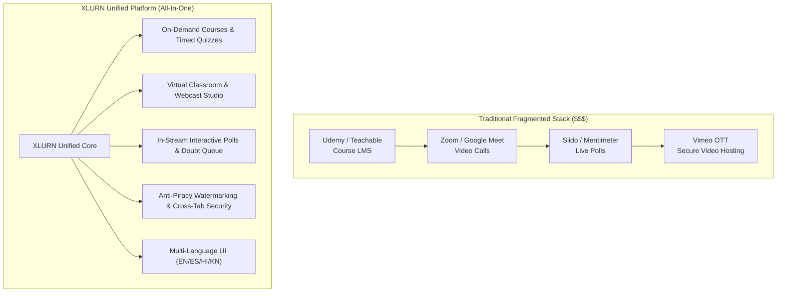

# Platform Comparison Document: XLURN vs. Industry-Leading EdTech & Streaming Platforms

---

## Executive Summary

The **XLURN Video Streaming & Virtual Classroom Platform** is engineered as an all-in-one ecosystem bridging the gap between **on-demand asynchronous learning** (e.g., Coursera, Udemy), **real-time synchronous virtual classrooms** (e.g., Zoom, Google Meet), and **live broadcast streaming** (e.g., YouTube Live). 

Most organizations today are forced to purchase, integrate, and maintain 3 to 4 fragmented software subscriptions:
1. An LMS for courses and quizzes (Udemy/Teachable).
2. A video conferencing tool for live lectures (Zoom/Teams).
3. A video hosting/CDN provider (Vimeo/Wistia/YouTube).
4. An administration and multi-tenant billing engine.

**XLURN consolidates these disparate silos into a single, cohesive, zero-friction web application.**

---

## Comprehensive Competitive Comparison Matrix

| Capability / Feature Area | **XLURN (Our Platform)** | **Udemy** | **Coursera** | **YouTube Live** | **Zoom / Google Meet** | **Teachable** |
| :--- | :---: | :---: | :---: | :---: | :---: | :---: |
| **All-in-One Synchronous + Asynchronous Hub** | ✅ **Native** | ❌ On-demand only | ❌ External links | ❌ Broadcast only | ❌ Meeting only | ⚠️ Basic 3rd-party embed |
| **Zero-Plugin Webcast Studio directly in Admin** | ✅ **Yes (WebRTC + Canvas)** | ❌ No live broadcast | ❌ No | ⚠️ Requires OBS/StreamYard | ⚠️ Native app required | ❌ No |
| **Real-Time Doubt Hand-Raising with Priority Queue** | ✅ **Integrated with broadcast** | ❌ None | ❌ None | ❌ None (Chat only) | ⚠️ Unordered hand list | ❌ None |
| **Live In-Stream Polling with Instant Result Aggregation** | ✅ **Native BroadcastChannel / WS** | ❌ None | ❌ None | ⚠️ Basic live chat poll | ⚠️ Paid add-on / separate | ❌ None |
| **Anti-Piracy Dynamic Watermarking (Floating User Identity)** | ✅ **Native Overlay Engine** | ❌ Static / None | ❌ None | ❌ None | ❌ None | ❌ None |
| **Cross-Tab Inactivity Detection & Auto-Logout** | ✅ **Synchronized across tabs** | ❌ Session cookie only | ❌ Session cookie only | ❌ None | ❌ None | ❌ None |
| **Interactive Study Rooms with Peer Collaboration** | ✅ **Built-in Dedicated Rooms** | ❌ None | ❌ Discussion forum only | ❌ None | ⚠️ Breakout rooms (ephemeral) | ❌ None |
| **Multi-Tier Hierarchy (Super Admin, Author Admin, Learner)** | ✅ **Native 3-Tier Multi-tenant** | ⚠️ Instructor / Student | ⚠️ Enterprise / Student | ❌ Channel owner / viewer | ⚠️ Admin / User | ⚠️ School owner / student |
| **Integrated Multi-Language Localization Engine** | ✅ **Instant Live Switcher (EN, ES, HI, KN, etc.)** | ⚠️ Static subtitle files | ⚠️ Subtitle files only | ⚠️ Automated captions | ⚠️ Cloud transcription | ❌ Single language |
| **Automated Milestone Certificates with Verification** | ✅ **Native Instant PDF Generator** | ⚠️ Completion certificate | ⚠️ Verified certificate | ❌ None | ❌ None | ⚠️ Basic template |
| **Hybrid Serverless & Distributed Deployment (GitHub Pages / HTTPS Resilient)** | ✅ **Dual-mode (Offline/Online/Mock/Live fallback)** | ❌ Cloud-dependent | ❌ Cloud-dependent | ❌ Cloud-dependent | ❌ Cloud-dependent | ❌ Cloud-dependent |

---

## Key Differentiators: What We Enabled That Competitors Lack

### 1. Unified Broadcast Studio Inside LMS Admin
* **The Industry Standard:** Platforms like Udemy and Teachable do not have native live broadcasting. Instructors must schedule a Zoom or unlisted YouTube link and paste it into course notes.
* **Our Implementation:** Instructors click **Go Live** directly from their Admin dashboard (`#/live-webcasts`). It activates the instructor's webcam, microphone, or screen share via native browser WebRTC and streams directly to all learners currently tuned in to `#/live/:id`.

### 2. Live Doubt Queue & Hand-Raising Synchronized with Broadcast
* **The Industry Standard:** In YouTube Live or Twitch, viewer doubts are drowned in high-speed text chats. In Zoom, hand-raises disrupt the speaker and lack integration with course syllabus progression.
* **Our Implementation:** Learners click **Raise Hand ✋** inside the player. The instructor's dashboard receives real-time queue notifications displaying the student's name and avatar. Instructors can address doubts sequentially, acknowledge the student, or bring them on stage without switching windows.

### 3. Native In-Stream Interactive Polling
* **The Industry Standard:** Instructors on Coursera or Udemy can only offer post-lecture static quizzes. Live tools like Slido or Mentimeter require external QR codes or browser tabs.
* **Our Implementation:** Instructors compose and launch live questions on the fly during a webcast. The question immediately appears on the learner's screen as an interactive overlay, tallying votes live with animated progress bars.

### 4. Dynamic Anti-Piracy Watermarking
* **The Industry Standard:** Recorded courses are frequently screen-recorded and shared illicitly on torrents or Telegram.
* **Our Implementation:** The video player embeds dynamic, semi-transparent watermark overlays displaying the authenticated student’s ID, timestamp, and email moving randomly across the viewport. If a user attempts to record their screen, their identity is irreversibly watermarked into the recording, deterring intellectual property theft.

### 5. Multi-Tab Synchronized Security & Inactivity Guard
* **The Industry Standard:** Most LMS platforms leave user sessions active indefinitely or expire cookies silently on refresh, creating security vulnerabilities on shared or public computers.
* **Our Implementation:** Incorporates cross-tab heartbeat synchronization (`localStorage` + native listener). If a learner is inactive across all open tabs for 10 minutes, the session securely triggers an auto-logout across every tab simultaneously.

### 6. Peer Collaborative Study Rooms
* **The Industry Standard:** Most platforms isolate students into solitary asynchronous watching. Discussion occurs in slow, asynchronous comment sections.
* **Our Implementation:** Learners can enter dedicated **Study Rooms** organized by subject or topic to exchange notes, discuss problem sets, and interact with peers in real time alongside their courses.

### 7. Dual Architecture: Hybrid Serverless + Cloud Resilient Fallback
* **The Industry Standard:** If the LMS backend or media server goes down, the entire app crashes to a blank white screen.
* **Our Implementation:** Features an intelligent dual-mode architecture:
  - When the backend WebSocket/Node API is online, it uses high-speed streaming and live database synchronization.
  - When deployed on static hosting (such as GitHub Pages HTTPS) or offline, it activates **`BroadcastChannel`** for tab-to-tab real-time sync, graceful mock live feeds, and comprehensive `ErrorBoundary` protection to ensure **zero white screens**.

---

## Architectural & Economic Value Proposition

### Cost & Maintenance Savings:
1. **Zero SaaS Redundancy:** Eliminates individual subscription fees for Zoom Pro ($200+/instructor/yr), Vimeo Enterprise ($600+/yr), and Slido ($300+/yr).
2. **Unified User Identity:** Students and instructors use a single login credential for courses, live classes, quizzes, and certificates.
3. **Data Sovereignty:** All viewer attendance, quiz scores, poll responses, and chat logs reside in a single database schema rather than scattered across third-party tools.

---

## Conclusion & Strategic Roadmap

The features built into the **XLURN Platform** position it ahead of traditional course-hosting platforms by treating **Live Interaction** as a first-class citizen alongside **On-Demand Content**. 

Instructors do not need technical expertise with broadcasting software like OBS; learners do not need external meeting links. Everything happens seamlessly within a unified, secure browser interface.
