# XLurn Enterprise Video Streaming Platform
## Comprehensive Admin Portal User Manual & Operations Guide

---

> **Document Purpose**: This guide provides full operational and administrative instructions for administrators and author managers using the **XLurn Admin Portal**. It covers system navigation, authentication protocols, media uploading, multi-chapter course authoring, analytics monitoring, and user administration.

---

### Table of Contents
1. [System Overview & Architecture](#1-system-overview--architecture)
2. [Authentication & Session Security](#2-authentication--session-security)
3. [Dashboard Command & Control Hub](#3-dashboard-command--control-hub)
4. [Author & Instructor Management](#4-author--instructor-management)
5. [User Management & Security Governance](#5-user-management--security-governance)
6. [Single Video Publishing Workflow](#6-single-video-publishing-workflow)
7. [Comprehensive Course Authoring & Chapter Builder](#7-comprehensive-course-authoring--chapter-builder)
8. [Catalog & Category Management](#8-catalog--category-management)
9. [Telemetry, Playback & User Analytics](#9-telemetry-playback--user-analytics)
10. [Reports Generation & Export Center](#10-reports-generation--export-center)
11. [Platform Settings & Multilingual Localization](#11-platform-settings--multilingual-localization)
12. [AI Predictive Insights & Intelligent Analytics](#12-ai-predictive-insights--intelligent-analytics)

---

### 1. System Overview & Architecture

The **XLurn Admin Portal** provides unified control over the video streaming ecosystem, catering to two primary administrative tiers:
- **Super Administrator (`super_admin`)**: Unrestricted global authority over platform settings, all client author accounts, user directories, global catalog curation, revenue reporting, and telemetry.
- **Author Administrator (`author_admin` / `admin`)**: Scoped access focused on uploading, authoring, and curating course catalogs, managing chapter lessons, monitoring specific student engagement, and video transcoding.

#### Service Endpoints:
| Service Component | Port / Route | Description |
| :--- | :--- | :--- |
| **Admin Portal Web App** | `http://localhost:3000` | Administrative React 19 single-page application |
| **End-User Streaming Portal** | `http://localhost:3001` | Learner streaming frontend |
| **Mock Backend API** | `http://localhost:5000` | REST API handling auth, courses, telemetry, and db sync |
| **High-Speed Upload Service** | `http://localhost:5050` | Resumable chunked video uploader with MinIO/disk storage |

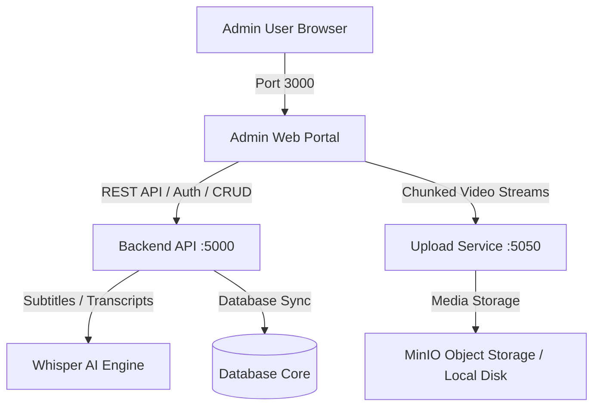

---

### 2. Authentication & Session Security

The Admin Portal enforces strict role-based access control (RBAC), multi-factor OTP verification, client-side encryption, and inactivity safeguards.

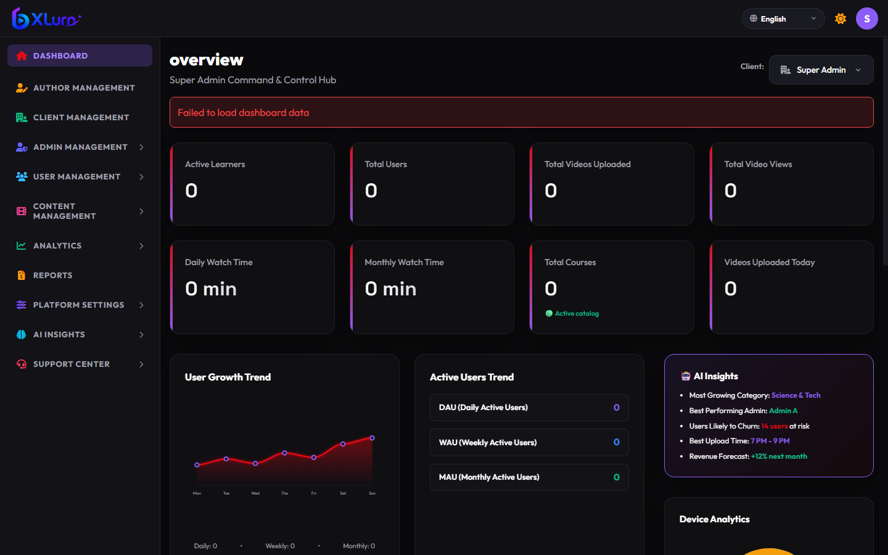

#### 2.1 Login Procedure:
1. Navigate to the login portal at `http://localhost:3000/#/login`.
2. Input registered **Email Address** and **Password**.
3. If Multi-Factor Authentication is enabled, provide the **6-digit verification PIN/OTP**.
4. Click **Sign In**.

#### 2.2 Security Features:
- **Client-Side Payload Encryption**: Sensitive authentication credentials are encrypted using RC4 stream encryption before leaving the client browser.
- **Cross-Tab Inactivity Auto-Logout**: If no user interaction (keystrokes, mouse movement, clicks) is detected across any open browser tab for **10 minutes**, the session is automatically terminated and the administrator is securely redirected to the login screen.
- **Role Guard Isolation**: End users (`role: 'user'`) attempting to log into the Admin portal are immediately rejected with an *Access Denied* notification.

---

### 3. Dashboard Command & Control Hub

Upon successful authentication, the command center displays high-level real-time telemetry, operational statistics, and system health status.

#### 3.1 Metric Summaries:
- **Total Published Courses & Lessons**: Aggregate count of active educational materials.
- **Registered Learners**: Total active vs. inactive learners in the database.
- **Bandwidth & Storage Telemetry**: Real-time CDN consumption and storage metrics.
- **Client Switcher (Super Admin)**: Allows switching administrative perspectives across individual Author Clients or viewing the global aggregate platform view.

---

### 4. Author & Instructor Management

Super Administrators can onboard, monitor, and configure independent instructors and content authors.

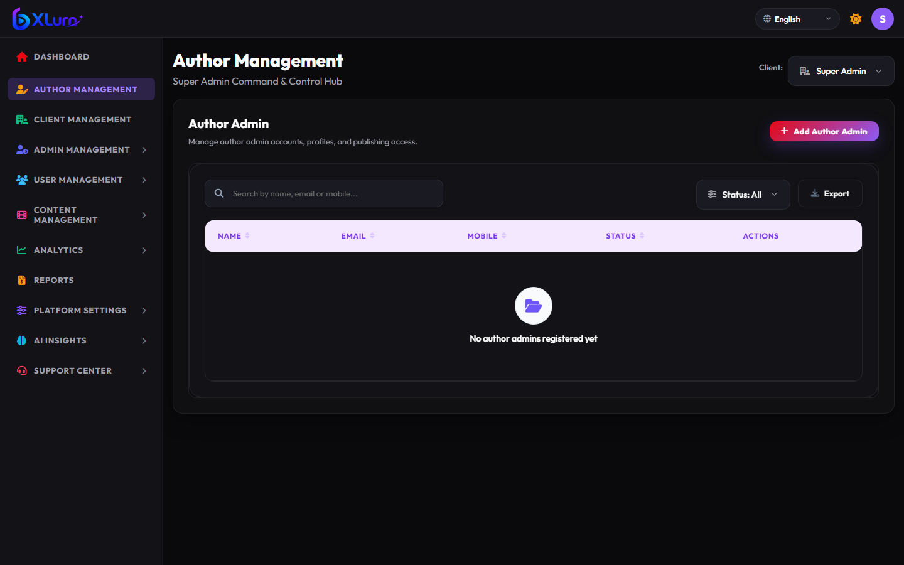

#### 4.1 Onboarding a New Author Admin:
1. Select **Author Management** from the primary sidebar.
2. Click the **+ Add Author Admin** button in the top right header.
3. Fill in the author profile information:
   - Full Name
   - Email Address & Phone Number
   - Default Publishing Quota
   - Department / Specialization
4. Click **Save Author Profile**. An automated invite with temporary credentials will be dispatched.

---

### 5. User Management & Security Governance

The **User Management** console provides comprehensive tools to oversee learner profiles, inspect activity logs, and isolate compromised accounts.

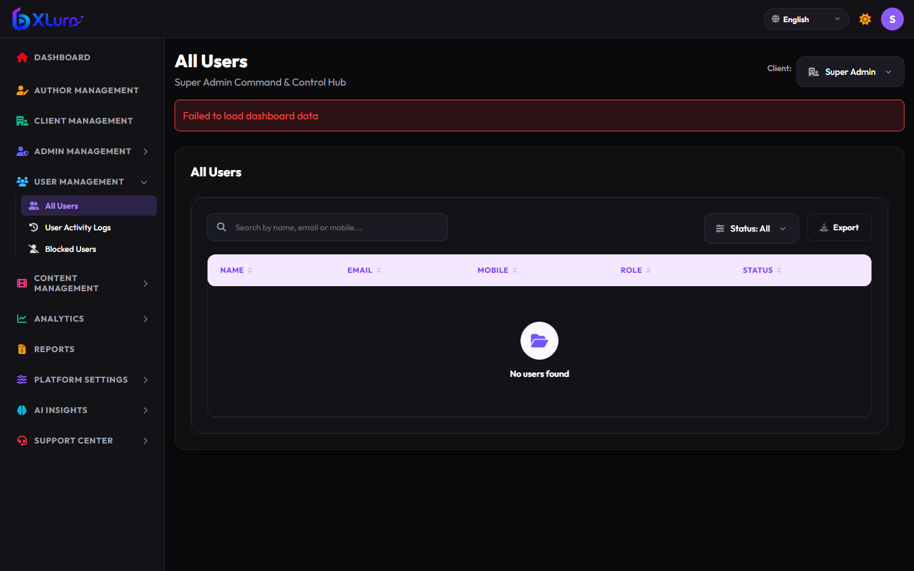

#### 5.1 User Table Capabilities:
- **Multi-Field Search**: Real-time search by learner name, email, or mobile number.
- **Status Filter**: Filter users by `Active`, `Pending`, or `Suspended`.
- **Role Badges**: Immediate visual indicators for `User`, `Admin`, and `Super Admin`.
- **Export Directory**: Export the active user view directly into CSV or Excel format.
- **Security Actions**:
  - **Block/Suspend User**: Instantly revokes session tokens and moves the user into the **Blocked Users** list.
  - **View Activity Log**: Inspects session history, IP addresses, and device fingerprints.

---

### 6. Single Video Publishing Workflow

The **Upload Video** module facilitates standalone video publishing with automated thumbnail generation, chunked file upload, and Whisper AI speech-to-text processing.

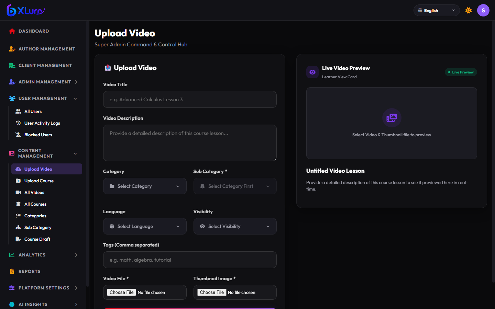

#### 6.1 Publishing Steps:
1. Open **Content Management** &rarr; **Upload Video**.
2. **Video Metadata**:
   - **Video Title**: Enter an informative lesson title.
   - **Video Description**: Summary of lesson objectives.
   - **Category & Subcategory**: Select appropriate domain taxonomy.
   - **Language & Visibility**: Select audio language and visibility (`Public`, `Private`, `Restricted`).
   - **Tags**: Comma-separated keywords for user search.
3. **Media Upload**:
   - **Video File**: Supports MP4, MOV, MKV, WebM. File upload utilizes high-speed chunked uploading (5MB slices) with live percentage progress.
   - **Thumbnail Image**: Custom JPG/PNG banner for the video card.
4. **Live Card Preview**: The right panel displays the exact learner card representation in real-time as metadata is typed.
5. **Whisper AI Subtitle Automation**: Once uploaded, the platform automatically transcribes speech into multi-language WebVTT subtitles and transcripts.

---

### 7. Comprehensive Course Authoring & Chapter Builder

The **Upload Course** interface is a structured, multi-tier curriculum builder designed for complex courses with multiple chapters, ordered video lectures, and supplemental download files.

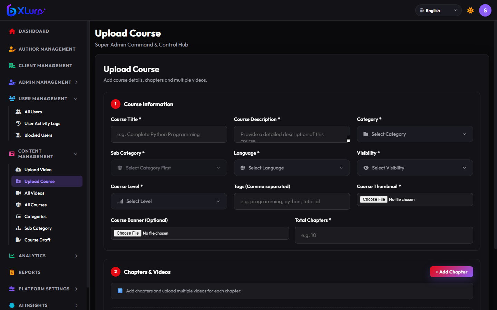

#### 7.1 Section 1: Course Information
- **Course Title & Description**: Core catalog descriptors.
- **Category & Subcategory**: Structured catalog placement.
- **Difficulty Level**: `Beginner`, `Intermediate`, or `Advanced`.
- **Course Thumbnail & Banner**: High-resolution branding graphics.

#### 7.2 Section 2: Chapters & Curriculum Builder
1. Click **+ Add Chapter** to create Module 1.
2. Provide Chapter Title (e.g., *Chapter 1: Foundations*).
3. Under the chapter accordion, click **+ Add Video** to attach lessons.
4. Upload lesson video files, assign individual video titles, and define lesson sequences.
5. Attach optional supplemental learning materials:
   - PDF guides, documentation (`.doc`, `.docx`)
   - Code archives (`.zip`, `.tar.gz`)
   - Presentation slides (`.pptx`)

#### 7.3 Smart Incremental Sync (Course Edit Mode):
> **Optimized Course Updates**: When modifying an existing course, the system automatically detects which specific chapter videos were newly uploaded or replaced. The subsequent background sync (`formstep: 'transcriptCourse'`) sends **only the modified chapters and videos**, avoiding redundant reprocessing and saving server bandwidth.

---

### 8. Catalog & Category Management

Centralized catalog oversight ensures courses and video categories stay organized and accessible.

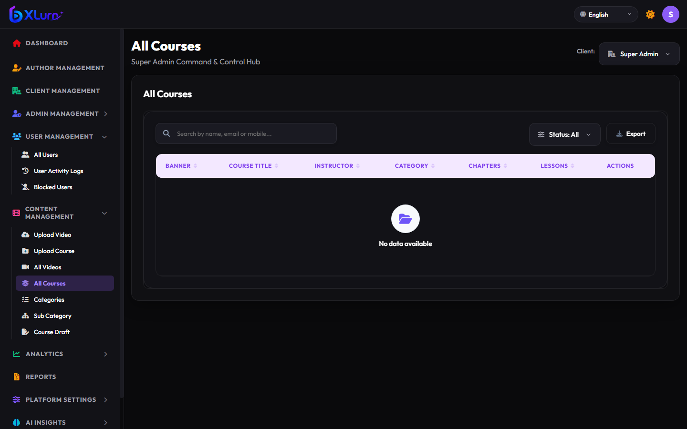

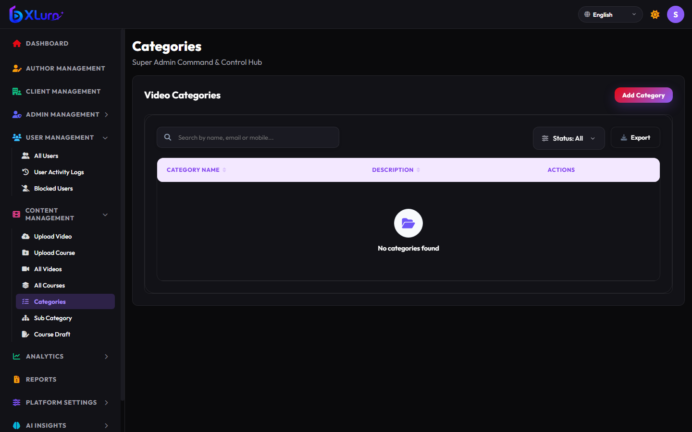

#### 8.1 All Courses Management:
- **Search & Filtering**: Search catalog items by instructor, title, or category.
- **Course Actions**:
  - ✏️ **Edit Course**: Loads curriculum directly into the multi-chapter builder for modifications.
  - 🗑️ **Delete Course**: Safely removes or archives course content.
  - 👁️ **Preview Course**: Inspects user-facing course layout and video playback.

#### 8.2 Category & Sub-Category Configuration:
- Create top-level domains (e.g., *Technology*, *Business*, *Design*).
- Define nested sub-categories (e.g., *Technology &rarr; Artificial Intelligence*).
- Categories dynamically cascade into video and course upload dropdowns.

---

### 9. Telemetry, Playback & User Analytics

The Analytics engine provides actionable insights into learner retention, video drop-off rates, and playback interactions.

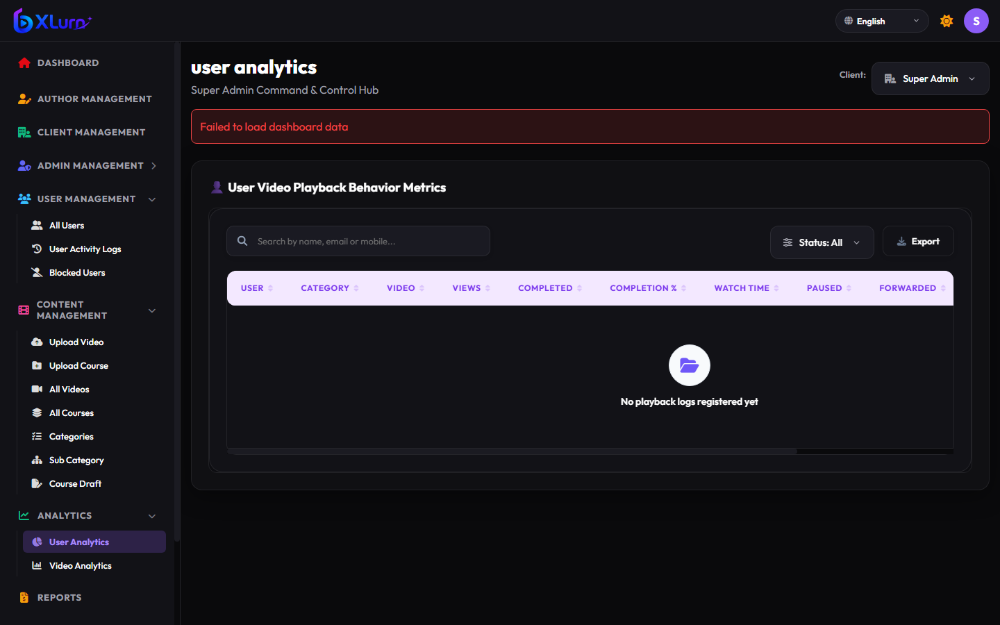

#### 9.1 Tracked Metrics:
- **Unique Views**: Distinct student view impressions.
- **Completion Percentage**: Ratio of learners completing &ge; 90% of the video duration.
- **Watch Time Total**: Aggregate hours and minutes consumed.
- **Engagement Interactions**: Frequency of video pauses, rewinds, and forwards to identify challenging lesson segments.

---

### 10. Reports Generation & Export Center

The Reports module enables administrators to extract structured data for audit, compliance, and financial accounting.

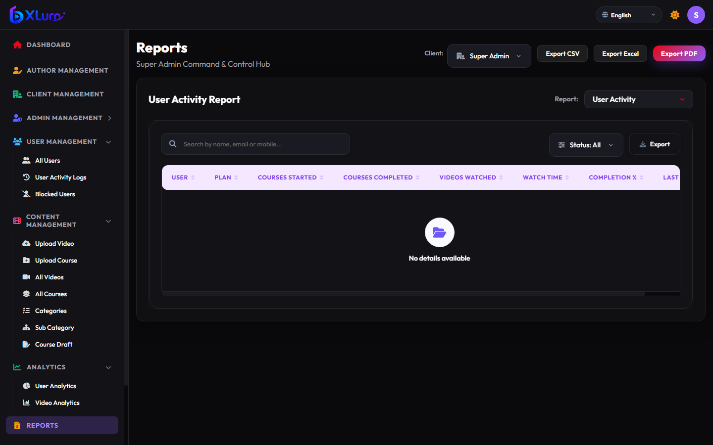

#### 10.1 Export Capabilities:
- **Supported Formats**: One-click export to **CSV**, **Excel (`.xlsx`)**, and **PDF Document**.
- **Report Types**:
  - User Activity & Progress Reports
  - Course Enrollment & Completion Reports
  - Bandwidth & Storage Utilization Audits
- **Date Range Filters**: Scope reports by custom date windows or predefined quarters.

---

### 11. Platform Settings & Multilingual Localization

Configure global streaming infrastructure, CDN routing, and UI language localization.

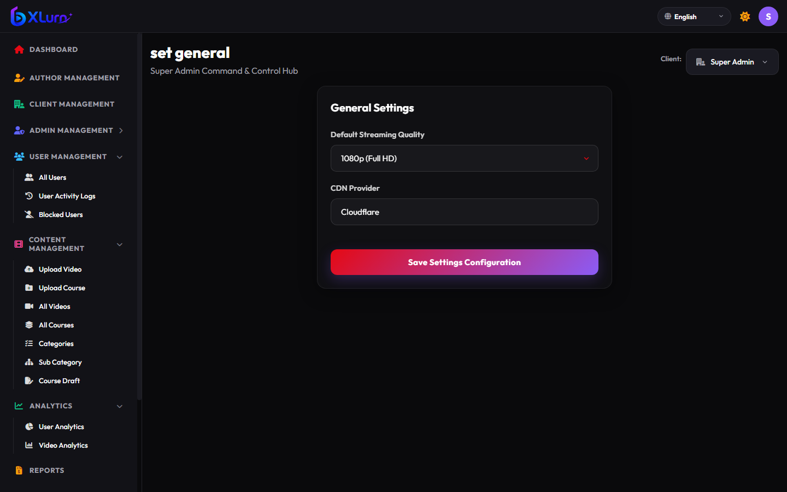

#### 11.1 Infrastructure Controls:
- **Default Streaming Quality**: Configure baseline adaptive bitrate profile (`1080p Full HD`, `720p HD`, or `Adaptive HLS`).
- **CDN Provider**: Toggle edge distribution routing between Cloudflare and Akamai.
- **Language Switcher**: Built-in support for 8+ localized interfaces (English, Hindi, Kannada, Tamil, Telugu, Spanish, French, German).

---

### 12. AI Predictive Insights & Intelligent Analytics

Harness machine learning models to anticipate churn, identify viral topics, and recommend curriculum improvements.

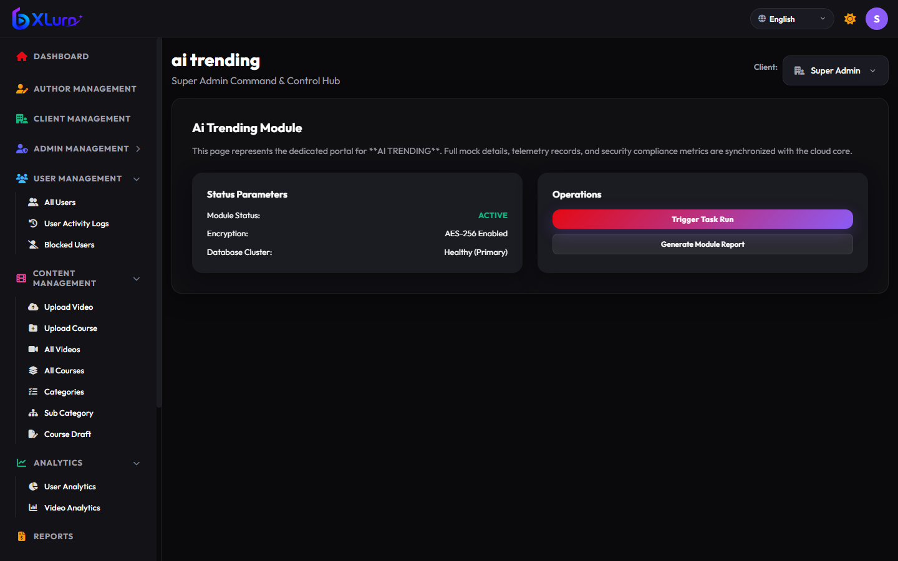

#### 12.1 Machine Learning Modules:
- **Trending Videos Detector**: Identifies velocity surges across popular lessons.
- **Learner Churn Predictor**: Flags accounts showing decreased weekly engagement before drop-off occurs.
- **Optimal Upload Window**: Computes peak platform concurrency to recommend ideal publishing times.

---

### Summary Checklist for Administrators

| Task | Module | Frequency |
| :--- | :--- | :--- |
| Check system telemetry & server health | **Dashboard Overview** | Daily |
| Publish new single videos or courses | **Content Management** | As Needed |
| Audit user activity & monitor blocked logins | **User Management** | Weekly |
| Review lesson completion & drop-off metrics | **Analytics Hub** | Weekly |
| Export administrative & financial spreadsheets | **Reports Center** | Monthly / Quarterly |
| Review AI churn and trending forecasts | **AI Insights** | Bi-weekly |
