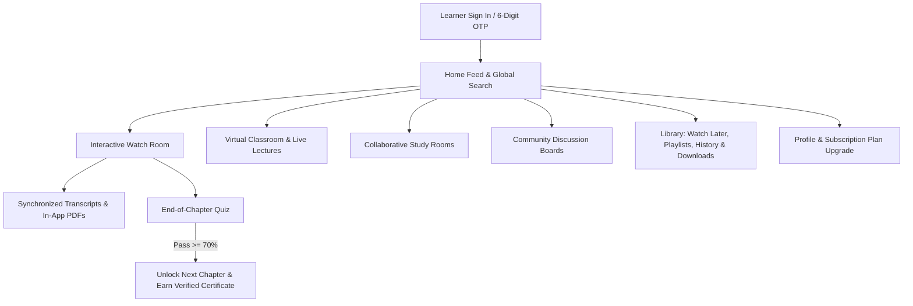
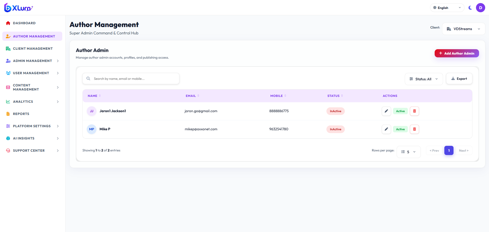
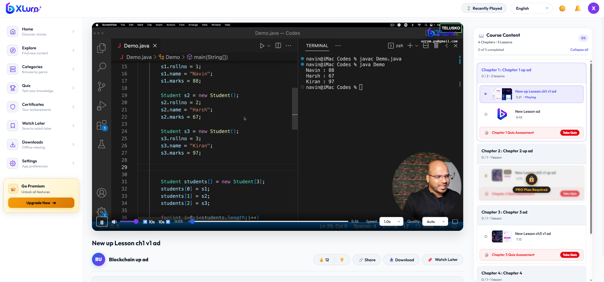
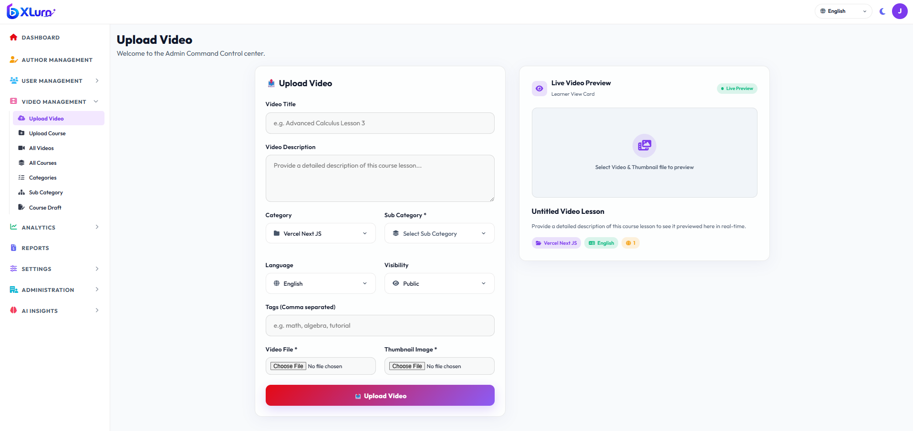
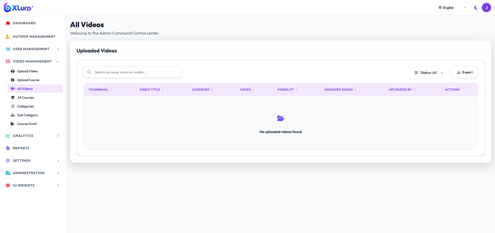
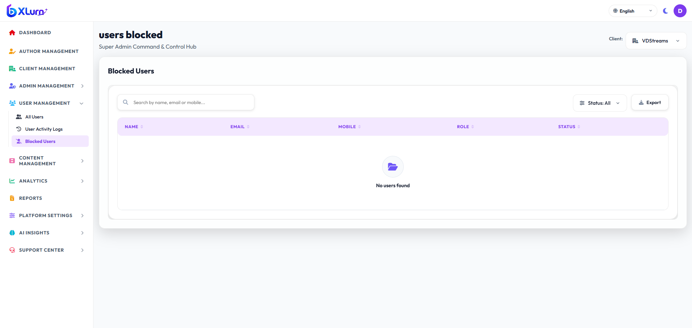
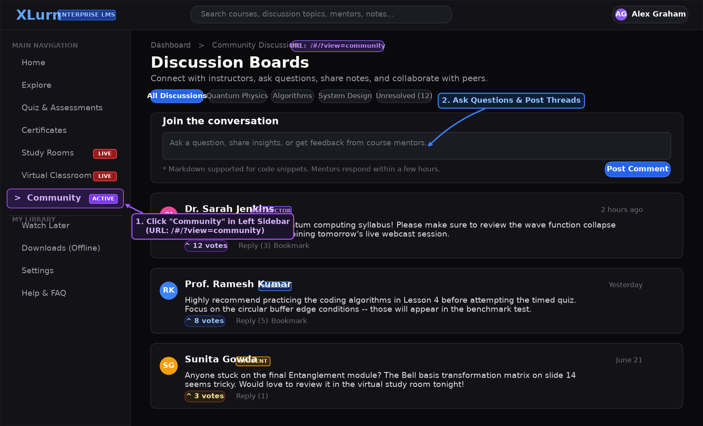
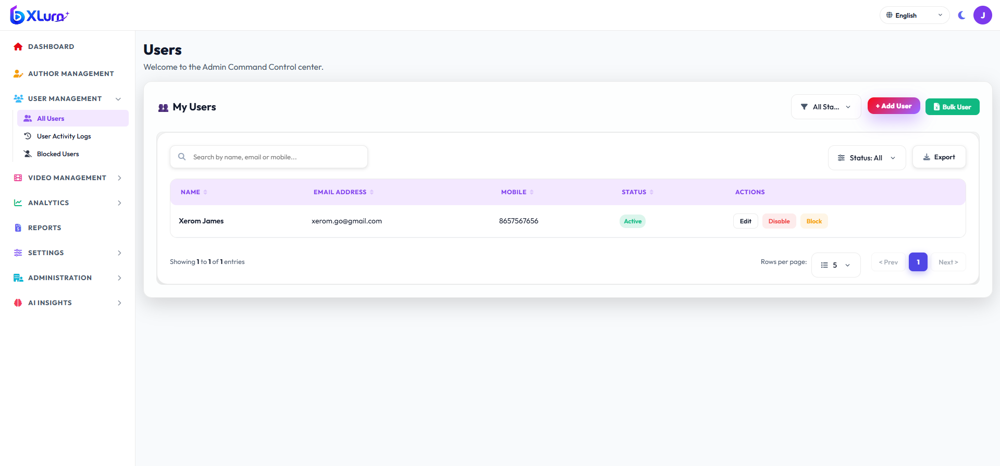
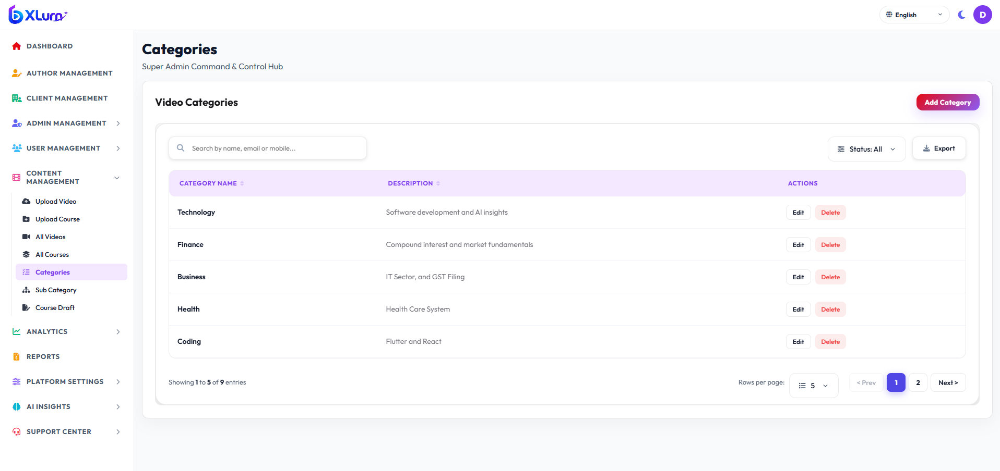
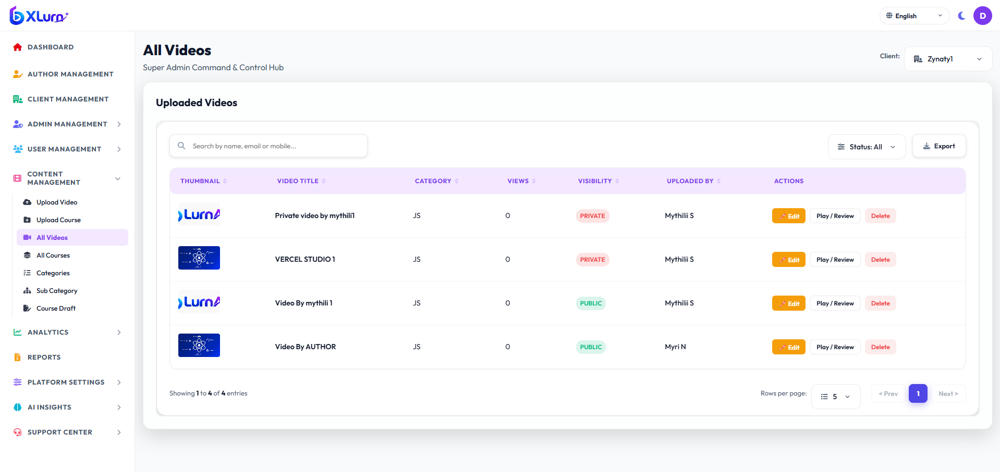

# XLurn Enterprise Video Streaming & Learning Platform
## Comprehensive Learner (User) Portal User Manual & Guide

---

> **Document Purpose**: This guide provides complete step-by-step instructions for learners and end users navigating the **XLurn User Streaming Portal** (`user-web-app`). It covers account registration, multi-factor authentication (6-digit OTP), home feed discovery, global instant search, the interactive Video Watch Room, multilingual subtitles & synchronized transcripts, live Virtual Classrooms, collaborative Study Rooms, Community discussion boards, chapter quizzes, playlists, watch history, offline downloads, earned certificates, profile settings, and subscription plan upgrades.

---

### Table of Contents
1. [Platform Overview & Key Capabilities](#1-platform-overview--key-capabilities)
2. [Account Registration, Login & 6-Digit OTP Verification](#2-account-registration-login--6-digit-otp-verification)
3. [Global Navigation Header & Instant Search](#3-global-navigation-header--instant-search)
4. [Sidebar Navigation & Discovery Views](#4-sidebar-navigation--discovery-views)
5. [Home Feed, Hover Previews & Category Browsing](#5-home-feed-hover-previews--category-browsing)
6. [Interactive Video Watch Room & Curriculum Player](#6-interactive-video-watch-room--curriculum-player)
7. [Multilingual Subtitles, Interactive Transcripts & Learning Resources](#7-multilingual-subtitles-interactive-transcripts--learning-resources)
8. [Virtual Classroom & Live Interactive Lectures](#8-virtual-classroom--live-interactive-lectures)
9. [Collaborative Study Rooms & Watch Parties](#9-collaborative-study-rooms--watch-parties)
10. [Community & Discussion Boards](#10-community--discussion-boards)
11. [Chapter Quizzes & Knowledge Assessments](#11-chapter-quizzes--knowledge-assessments)
12. [Watch Later, Custom Playlists, Watch History & Downloads](#12-watch-later-custom-playlists-watch-history--downloads)
13. [Earned Certificates & Credentials](#13-earned-certificates--credentials)
14. [User Profile, Security & Preferences](#14-user-profile-security--preferences)
15. [Subscription Plans & Pricing Upgrades](#15-subscription-plans--pricing-upgrades)
16. [Help & FAQ Center, Policies & Troubleshooting](#16-help--faq-center-policies--troubleshooting)

---

### 1. Platform Overview & Key Capabilities

The **XLurn User Portal** (`http://localhost:3001`) is a modern, responsive learning and video streaming application designed for seamless course consumption, live classroom engagement, interactive skill assessment, and personalized progress tracking across desktop, tablet, and mobile devices.

#### Core Learner Features at a Glance:
| Module / Feature | Description |
| :--- | :--- |
| **Smart Home Feed & Explore** | Personalized hero spotlight, *Continue Watching* progress bars, trending courses, and YouTube-style silent hover video previews. |
| **Global Instant Search (`/` or `Ctrl+K`)** | Categorized real-time search across Courses, Video Lessons, Downloadable PDFs/Resources, and Categories. |
| **Interactive Video Watch Room** | Adaptive HD/4K player with custom playback speeds (`0.75x`–`2.0x`), quality switching, auto-resume, and anti-piracy dynamic watermarks. |
| **Multilingual Subtitles & Transcripts** | Synchronized WebVTT closed captions and clickable, searchable transcripts in **English**, **Hindi (हिंदी)**, **Kannada (ಕನ್ನಡ)**, and **Telugu (తెలుగు)**. |
| **Virtual Classroom (`/live-classes`)** | Interactive real-time live lectures with low-latency webcast, Raise Hand, live student polls, attendee counters, and live classroom chat. |
| **Collaborative Study Rooms (`/study-rooms`)** | Peer group study spaces with 6-character room codes, course topic associations, and synchronized Pomodoro focus timers. |
| **Community Discussion Forum (`/?view=community`)** | Course and topic discussion boards with question posting, answer upvotes, and instructor verification badges. |
| **Automated Chapter Quizzes (`/quizzes`)** | End-of-chapter knowledge checks (MCQ, True/False, Fill-in-the-Blank) with instant grading, passing thresholds ($\ge 70\%$), and centralized quiz history. |
| **Personal Library Management** | Save videos to **Watch Later**, organize custom **Playlists**, inspect **Watch History**, and manage **Offline Downloads**. |
| **Certificates & Achievements (`/certificates`)** | View and download verified PDF certificates with authentic credential IDs upon course completion. |
| **Multilingual UI & Theme Modes** | Switch the entire portal interface between **English**, **हिंदी**, and **ಕನ್ನಡ**, and toggle **Dark / Light Mode** anytime. |

---

### 2. Account Registration, Login & 6-Digit OTP Verification

XLurn safeguards your learning journey with end-to-end security, RC4-encrypted credentials, and multi-factor 6-digit One-Time Password (OTP) verification.

#### 2.1 Creating a New Learner Account (Sign Up)
1. Open the XLurn User Portal at `http://localhost:3001/#/signup`.
2. Fill in the required fields:
   - **Full Name**: Your legal or student name for certificates.
   - **Email Address**: Registered email for notifications and OTP codes.
   - **Mobile Number**: Contact number for SMS alerts.
   - **Password**: Secure password meeting complexity guidelines.
3. Click **Create Account / Sign Up**.
4. Upon successful registration, you will be redirected to the sign-in screen.

#### 2.2 Signing In (`#/login`)
1. Navigate to `http://localhost:3001/#/login`.
2. Enter your registered **Email Address** and **Password**.
3. Toggle the **Eye icon** to visually inspect your typed password, and optionally check **Remember Me** to maintain your local session.
4. Click **Sign In**.

#### 2.3 Two-Factor Authentication (6-Digit OTP Verification)
When multi-factor verification is activated, the login screen seamlessly transitions to the **OTP Verification** screen:
- **Individual 6-Digit Box Inputs**: The screen presents six individual numeric input boxes. As you type each digit, focus automatically advances to the subsequent box.
- **Full Clipboard Paste Support**: You can copy a 6-digit verification code from your email or authenticator and paste it into the first box; all six digits populate immediately.
- **120-Second (2-Minute) Countdown Timer**: An on-screen timer displays `Resend OTP in mm:ss` counting down from 120 seconds.
- **Resend OTP**: If the code is not received or the countdown reaches `0:00`, the **Resend OTP** button activates, allowing you to trigger a fresh code dispatch.
- **Automated Submission**: Once the 6th digit is entered, the form validates automatically and logs you in.
- **Back to Sign In**: Click `← Back to Sign In` at any point to cancel OTP verification and return to credentials entry.

#### 2.4 Forgot & Reset Password Flow
1. On the Login screen, click **Forgot Password?** (`#/forgot-password`).
2. Enter your registered **Email Address** and click **Send Reset Link / Token**.
3. Enter the **Reset Token / OTP** sent to your inbox, provide your **New Password**, confirm the password, and click **Reset Password** to restore access.

#### 2.5 Session Security & Cross-Tab Inactivity Auto-Logout
- **10-Minute Inactivity Protection**: If no mouse movements, keyboard presses, scroll actions, or touch events occur across any open browser tab for **10 minutes**, the portal terminates the active session to protect your privacy and displays an alert: *"You have been automatically logged out due to 10 minutes of inactivity."*
- **Role Verification**: The User Portal strictly admits authenticated learner accounts (`role: 'user'`).

---

### 3. Global Navigation Header & Instant Search

The persistent top navigation bar provides instant access to global search, watch history quick links, system alerts, theme options, and profile settings.

#### 3.1 Global Instant Search (`/` or `Ctrl+K` / `Cmd+K`)
1. Click the top search bar or press **`/`** (or **`Ctrl+K`**) from anywhere in the application.
2. **Recent Searches & Popular Topics**: Prior to typing, the dropdown displays your recent search history (with single-item `✕` remove and *Clear All* actions) along with one-click trending topic tags (*React*, *AI & Machine Learning*, *Quantum Computing*, *Data Science*, etc.).
3. **Live Categorized Grouping**: As you type, results populate in real time into four distinct categories:
   - 🎓 **Courses**: Shows course thumbnail, title, instructor name, lesson count, and category.
   - 🎬 **Videos & Lessons**: Shows lesson thumbnail, title, category, and duration.
   - 📄 **Resources & Documents**: Matches attached lesson PDFs, slide decks, and study notes.
   - 🏷️ **Categories & Topics**: Direct links to domain catalogues.
4. Press **`Enter`** or click **View all results** to filter the main home catalog.

#### 3.2 Recently Played Quick Dropdown
- Click the **Recently Played** pill button in the top bar to inspect your latest watched lessons without navigating away from your active page.
- Filter recent history by:
  - **Last 7 days**
  - **Last 1 month**
  - **More than 1 month**
- Each card displays your completion percentage progress bar and offers one-click instant resume.

#### 3.3 Real-Time Notifications Center (`🔔`)
- Click the **Bell icon** in the top-right corner to review platform announcements, instructor notifications, and new course publications.
- Unread notifications highlight with an active counter badge.

#### 3.4 Theme Toggle & Multilingual UI Switcher
- **Dark / Light Theme**: Click the **Sun / Moon** toggle to switch between dark cinematic mode and clean high-contrast light mode.
- **Multilingual UI Switcher (`🌐`)**: Switch the entire portal interface instantaneously between:
  - **English (`en`)**
  - **Hindi (`hi` - हिंदी)**
  - **Kannada (`kn` - ಕನ್ನಡ)**

---

### 4. Sidebar Navigation & Discovery Views

The collapsible left navigation drawer (`Sidebar`) organizes all learning destinations into dedicated views:

| Sidebar Item | Route / View | Purpose & Functionality |
| :--- | :--- | :--- |
| 🏠 **Home** | `/` (`view=home`) | Hero spotlight banner, *Continue Watching* progress row, and categorized course carousels. |
| 🧭 **Explore** | `/?view=explore` | Discover trending, top-rated, and newly published lectures and masterclasses. |
| 🗂️ **Categories** | `/?view=categories` | Browse courses and standalone lessons by subject domain (*Science*, *Technology*, *Finance*, *AI*, *Business*, *Health*, *Coding*). |
| 🔴 **Virtual Classroom** | `/live-classes` | Directory of live instructor webcasts, upcoming webinars, and interactive classroom streams. |
| 👥 **Study Rooms** | `/study-rooms` | Collaborative peer study rooms, watch parties, join-by-code, and shared Pomodoro timers. |
| 💬 **Community** | `/?view=community` | Public student discussion boards, questions, answers, upvotes, and instructor responses. |
| 🏆 **Quiz Assessments** | `/quizzes` | Centralized quiz history, scores, passing status ($\ge 70\%$), question review, and retakes. |
| 📜 **Certificates** | `/certificates` | View and download authenticated course completion certificates (PDF) with credential IDs. |
| 🔖 **Watch Later** | `/?view=watch_later` | Bookmarked lessons and courses saved for subsequent focused review. |
| 📑 **Playlist** | `/?view=playlist` | Create, manage, and sequentially play custom topic study playlists. |
| 🕒 **Watch History** | `/?view=watch_history` | Chronological playback history log with watch duration and completion progress bars. |
| 📥 **Downloads** | `/?view=downloads` | Manage encrypted video lectures and PDF resources saved for offline viewing. |
| ⚙️ **Settings** | `/?view=settings` | Configure video playback defaults, notification subscriptions, and language. |
| ❓ **Help & FAQ** | `/faq` | Categorized self-service knowledge base, playback troubleshooting, and billing guidance. |

> **Go Premium Card**: At the base of the sidebar, the *Go Premium* card provides a quick **Upgrade Now ➔** shortcut to unlock 4K Ultra HD streaming, locked lessons, and offline downloads.

---

### 5. Home Feed, Hover Previews & Category Browsing

#### 5.1 Hero Spotlight & Continue Watching
- **Hero Spotlight**: Highlights flagship courses with direct **Watch Now** and **Curriculum Details** action buttons.
- **Continue Watching Row**: Displays in-progress courses with an interactive progress bar showing your exact percentage completion.

#### 5.2 YouTube-Style Silent Hover Video Previews
- Hover your mouse cursor over any course or video thumbnail on Home, Explore, or Categories to trigger a **silent instant video preview** directly inside the card canvas.

#### 5.3 Filtering by Category & Difficulty
- Click any **Category Chip** (*All*, *Science*, *Technology*, *Finance*, *AI*, *Business*, *Health*, *Coding*) to instantly filter matching courses.
- Cards clearly display difficulty tags (*Beginner*, *Intermediate*, *Advanced*), instructor names, run times, view counts, and premium lock badges.

---

### 6. Interactive Video Watch Room & Curriculum Player

Clicking any course or video card opens the **Video Watch Room** (`#/watch/:id`), split into the primary video theater on the left and the **Course Curriculum Accordion** on the right.

#### 6.1 Custom HTML5 Video Player Controls
- **Play / Pause**: Click the video canvas or press the **`Spacebar`**.
- **Quick Seek (`-10s` / `+10s`)**: Jump backward or forward 10 seconds with one click.
- **Playback Speed Selector**: Choose lecture speeds between **`0.75x`**, **`1x`**, **`1.25x`**, **`1.5x`**, and **`2.0x`**.
- **Resolution / Quality Selector**: Toggle seamlessly between **`Auto`**, **`1080p`**, **`720p`**, and **`480p`**. The player preserves your exact playback timestamp during switches.
- **Volume & Mute Slider**: Adjust audio output levels or mute instantly.
- **Smart Timestamp Auto-Resume**: The player remembers where you left off and resumes automatically upon returning.
- **Fullscreen Theater Mode**: Click the Fullscreen icon to expand the player while maintaining access to all custom controls, subtitles, and watermarks.

#### 6.2 Anti-Piracy Dynamic Watermarking
- During playback, the player renders a dynamic overlay displaying the platform brand logo and your **logged-in Email Address** across the screen to prevent unauthorized capture.

#### 6.3 Course Curriculum & Chapter Accordion
- Structured into sequential chapters (**Chapter 1 : [Title]**, **Chapter 2 : [Title]**, etc.).
- Displays lesson duration, completion checkmarks, and active indicators.
- **Free vs. Premium Content Access**:
  - Free users (`user_plan = 1`) stream public lessons.
  - Private lessons display a **Lock badge (`🔒`)**. Clicking a locked lesson opens the upgrade modal.
  - During auto-advance, locked lessons are automatically skipped to ensure uninterrupted learning.

---

### 7. Multilingual Subtitles, Interactive Transcripts & Learning Resources

Beneath the video player, three interactive tabs support comprehensive study:

#### 7.1 Closed Captions (`CC`) & Multilingual Subtitles
1. Click the **`CC`** button in the video player control bar.
2. Toggle captions **On / Off** and select your preferred language:
   - **English (`en`)**
   - **Hindi (`hi`)**
   - **Kannada (`kn`)**
   - **Telugu (`te`)**
3. Captions render dynamically in sync with the instructor's spoken dialogue.

#### 7.2 Interactive Synchronized Transcript Tab
1. Select the **Transcript** tab below the video player.
2. **Live Auto-Scroll & Highlighting**: The currently spoken sentence is highlighted and scrolled into view automatically. You can toggle auto-scroll at any time.
3. **Click-to-Seek**: Click any timestamped transcript cue line to jump playback directly to that exact second.
4. **Search Within Transcript**: Enter keywords in the transcript search box to highlight matching cues instantly.
5. **Copy Full Transcript**: Click **Copy Transcript** to copy lecture notes to your clipboard.

#### 7.3 Learning Resources & In-App PDF Previewer
1. Select the **Resources** tab to view supplemental chapter files.
2. **Filter Attachments**: Filter by **All**, **Audio**, **PDF / Documents**, or **Other**.
3. **In-App Document Preview Modal**: Click **Preview** on any attached PDF, text document, or slide deck to read it inside the built-in modal viewer without leaving the page.
4. **Integrated Chapter Audio Player**: Stream supplemental audio guides or lecture podcasts with dedicated seek and speed controls.

---

### 8. Virtual Classroom & Live Interactive Lectures

The **Virtual Classroom** (`#/live-classes` and `#/live/:id`) enables real-time interactive lectures, workshops, and webinars directly inside XLurn.

#### 8.1 Live Classes Directory (`#/live-classes`)
Navigate to **Sidebar &rarr; Virtual Classroom** to browse scheduled sessions:
- **Status Filter Tabs**: Filter sessions by:
  - **All**: Displays all scheduled, active, and past sessions.
  - **Live Now (`🔴 LIVE NOW`)**: Shows active broadcasts open for immediate attendance.
  - **Upcoming (`🔵 UPCOMING`)**: Shows scheduled webinars with *Set Reminder* actions.
  - **Recorded (`⚪ RECORDED`)**: Access recorded archives of completed sessions.
- **Session Cards**: Display session title, instructor avatar, category, scheduled time, and attendee count. Click any card to enter the classroom.

#### 8.2 Inside the Live Classroom (`#/live/:id`)
The virtual classroom provides an immersive learning environment:
1. **Low-Latency Video Stream**: High-definition video webcast from the instructor.
2. **Live Attendee Counter**: Real-time counter of peers and instructors in the room.
3. **Raise Hand (✋)**: Click the **Raise Hand** button to notify the instructor when you have a question.
4. **Interactive Live Polls**: When the instructor broadcasts a poll, an interactive voting card appears on screen. Select your choice to see real-time class voting percentages.
5. **Classroom Live Chat**: Real-time messaging with classmates and instructors. Instructor messages feature verified badges and distinct styling.
6. **Class Notes & Supplemental Tabs**:
   - **Lesson Notes Tab**: Live markdown lecture notes and outlines.
   - **Slide Resources Tab**: Downloadable slide decks, code snippets, and worksheets.
   - **Instructor Bio Tab**: Background information and credentials of the presenter.
7. **Exit Classroom**: Click *Exit Classroom* at any time to return safely to the Live Classes hub.

---

### 9. Collaborative Study Rooms & Watch Parties

The **Study Rooms** workspace (`#/study-rooms`) provides peer-to-peer study spaces for group accountability and collaborative review:

- **Join via 6-Character Code**: Enter a 6-character room code shared by a friend to join a private study group instantly.
- **Create a Custom Room**: Click **+ Create Room**, name the session, link a course or subject, and set member limits.
- **Shared Focus Timer**: Synchronized Pomodoro timer (25 minutes study, 5 minutes break) visible to all participants.
- **Collaborative Discussion**: Dedicated group chat for sharing timestamps, questions, and reference links.

---

### 10. Community & Discussion Boards

Accessed via **Sidebar &rarr; Community** (`/?view=community`), the Community forum connects learners across courses:

- **Topic & Tag Filtering**: Search and filter questions by tags such as `#React`, `#Python`, `#AI`, `#Algorithms`, and `#Career`.
- **Ask Questions**: Post detailed queries with code blocks and course references.
- **Upvote Solutions**: Upvote well-explained answers to surface the most helpful solutions.
- **Instructor-Verified Badges**: Responses verified by course authors feature an official verification checkmark.

---

### 11. Chapter Quizzes & Knowledge Assessments

#### 11.1 Taking a Chapter Quiz
- **Automatic Trigger**: Finishing all playable videos in a chapter automatically launches the **Chapter Quiz Modal**.
- **Manual Launch**: Click the **Take Quiz** button inside the chapter accordion in the Watch Room.
- **Supported Question Types**:
  1. **Multiple Choice (MCQ)**: Select the correct choice among options.
  2. **True / False**: Click the True or False card.
  3. **Free Text / Fill-in-the-Blank**: Enter your text response. Blank or whitespace-only inputs are disallowed; the *Next* and *Submit Quiz* buttons unlock only after entering valid characters.
- **Grading & Passing Score**: Scoring **70% or higher** awards a **Passed** grade and unlocks the subsequent chapter.

#### 11.2 My Quizzes Hub (`#/quizzes`)
Navigate to **Sidebar &rarr; Quiz** to view your comprehensive testing records:
- **Summary Cards**: Track total quizzes completed, passing rate, and average score.
- **Status Filter**: Filter attempts by **All**, **Passed (`🟢 Passed`)**, or **Failed (`🔴 Failed`)**.
- **Review & Retake**: Click **👁 View** to review answer breakdowns, or click **Retry** on failed quizzes to achieve a passing grade.

---

### 12. Watch Later, Custom Playlists, Watch History & Downloads

#### 12.1 Watch Later (`/?view=watch_later`)
- **Bookmarking**: Click the **`🔖 Watch Later`** button below any video or card.
  - *First Click*: Displays confirmation: *"Video has been added to watch later."*
  - *Subsequent Click*: Displays notice: *"Video is already in watch later."*
- **Queue Management**: Access your list from the sidebar to play or remove saved lessons.

#### 12.2 Custom Playlists (`/?view=playlist`)
1. Click **+ Create New Playlist**, give it a title and description, and add videos.
2. Play entire playlists sequentially or reorder lessons for customized exam preparation.

#### 12.3 Watch History (`/?view=watch_history`)
- Chronological record of all watched lessons, featuring precise watch duration, completion percentages, and search filtering.

#### 12.4 Offline Downloads (`/?view=downloads`)
- Intermediate and Premium subscribers can download eligible video lectures and PDFs for offline viewing without an active internet connection.

---

### 13. Earned Certificates & Credentials

1. Open **Sidebar &rarr; Certificates** (`#/certificates`).
2. Each earned credential card displays:
   - **Course Title & Achievement Badge (`🎓` / `🏆`)**
   - **Verified Final Score Percentage** (e.g., `95%`)
   - **Issuing Academy & Issue Date**
   - **Unique Credential ID** (e.g., `CERT-TSB-2026-9481`)
3. Click **📥 Download Certificate (PDF)** to save an official verified PDF for professional portfolios and LinkedIn profiles.

---

### 14. User Profile, Security & Preferences

Click your top-right avatar and select **Profile** (`#/profile`):

#### 14.1 Activity Metrics & Profile Picture
- **Learning Statistics**: View real-time counters for Videos Watched, Watch Later queue size, and Quizzes/Downloads completed.
- **Profile Photo Moderation**: Upload a personal avatar. Automated client-side moderation blocks explicit content or inappropriate filenames.
- **Edit Personal Details**: Update your **Full Name**, **Mobile Number**, and bio.

#### 14.2 Password & Security Management
- Update your login password under the Security modal with current password verification.

#### 14.3 Notification Preferences
- Customize alert subscriptions for course updates, quiz reminders, and weekly learning digests.

---

### 15. Subscription Plans & Pricing Upgrades

Navigate to **Plans & Pricing** (`#/plans`) via the sidebar *Go Premium* card to compare membership tiers:

| Feature / Benefit | Free Plan (`₹0`) | Intermediate Plan (`₹149/mo` or `₹1,429/yr`) | Premium Plan (`₹299/mo` or `₹2,870/yr`) |
| :--- | :---: | :---: | :---: |
| **Course & Lesson Access** | Limited Public Content | Most Courses & Videos | **All Content & Originals Unlocked** |
| **Max Streaming Quality** | 720p HD | 1080p Full HD | **4K Ultra HD** |
| **Simultaneous Devices** | 1 Device | 2 Devices | **4 Devices** |
| **Ad Experience** | Ad-Supported | Reduced Ads | **100% Ad-Free** |
| **Offline Downloads** | ❌ Locked | ✅ Included | ✅ **Included + Early Access** |

> **Annual Billing**: Toggle the billing switch to **Yearly Billing** to save **20%** across Intermediate and Premium tiers.

---

### 16. Help & FAQ Center, Policies & Troubleshooting

#### 16.1 System Alerts & Notifications Reference
| Alert / Condition | Message Displayed | Cause & Resolution |
| :--- | :--- | :--- |
| **Inactivity Auto-Logout** | *"You have been automatically logged out due to 10 minutes of inactivity."* | No user activity detected for 10 minutes across open tabs. Log back in to resume. |
| **Account Deactivated (HTTP 430)** | *"Your account has been deactivated. Please contact your administrator."* | Learner account was suspended by an organization administrator. Contact support. |
| **Duplicate Watch Later (HTTP 431)** | *"Video is already in watch later."* | The video is already bookmarked. Access it from **Sidebar &rarr; Watch Later**. |
| **Plan Upgrade Required** | *"Need to upgrade your plan"* | Attempted to stream a private lesson or download a file on Free tier. Upgrade at `#/plans`. |
| **Invalid / Expired OTP** | *"Invalid OTP" / "OTP Expired"* | Incorrect digits entered or 120s timer expired. Click *Resend OTP* to receive a new code. |
| **Content Moderation** | *"Inappropriate content has been detected in the uploaded file."* | Profile avatar triggered safety filters. Upload a standard personal portrait image. |

#### 16.2 Help Center & Legal Documentation
- **Help & FAQ (`#/faq`)**: Step-by-step guides for video playback, subtitle customization, quiz scoring, and billing inquiries.
- **Privacy Policy (`#/privacy`)**: Details regarding user data privacy, RC4 encryption, and regulatory compliance.
- **Terms & Conditions (`#/terms`)**: Platform acceptable use policy, anti-piracy terms, and intellectual property protections.

---

*XLurn Enterprise Video Streaming & Learning Platform — Learner User Manual*
