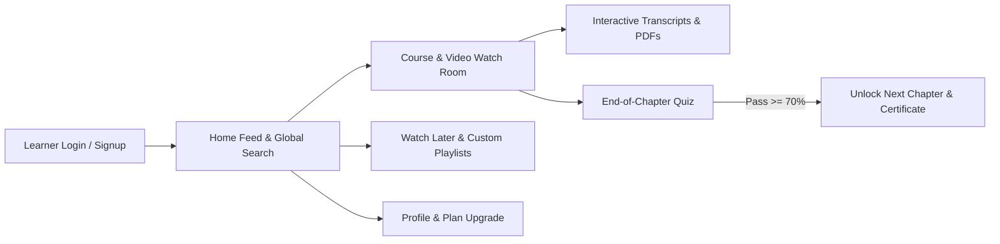

# XLurn Enterprise Video Streaming & Learning Platform
## Comprehensive Learner (User) Portal User Manual & Guide

---

> **Document Purpose**: This guide provides complete step-by-step instructions for learners and end users using the **XLurn User Streaming Portal** (`user-web-app`). It covers account registration, multi-factor authentication, home feed discovery, global search, the interactive Video Watch Room, multilingual subtitles & synchronized transcripts, chapter quizzes, playlists, watch history, offline downloads, earned certificates, profile settings, and subscription plan upgrades.

---

### Table of Contents
1. [Platform Overview & Key Capabilities](#1-platform-overview--key-capabilities)
2. [Account Registration, Login, 2FA OTP & Password Recovery](#2-account-registration-login-2fa-otp--password-recovery)
3. [Global Navigation Header & Instant Search](#3-global-navigation-header--instant-search)
4. [Sidebar Navigation & Discovery Views](#4-sidebar-navigation--discovery-views)
5. [Home Feed, Hover Previews & Category Browsing](#5-home-feed-hover-previews--category-browsing)
6. [Interactive Video Watch Room & Curriculum Player](#6-interactive-video-watch-room--curriculum-player)
7. [Multilingual Subtitles, Interactive Transcripts & Learning Resources](#7-multilingual-subtitles-interactive-transcripts--learning-resources)
8. [Chapter Quizzes & Knowledge Assessments](#8-chapter-quizzes--knowledge-assessments)
9. [Watch Later, Custom Playlists, Watch History & Downloads](#9-watch-later-custom-playlists-watch-history--downloads)
10. [Earned Certificates & Credentials](#10-earned-certificates--credentials)
11. [User Profile, Security & Preferences](#11-user-profile-security--preferences)
12. [Subscription Plans & Pricing Upgrades](#12-subscription-plans--pricing-upgrades)
13. [Troubleshooting & System Notifications Reference](#13-troubleshooting--system-notifications-reference)

---

### 1. Platform Overview & Key Capabilities

The **XLurn User Portal** (`http://localhost:3001`) is a modern, responsive learning and video streaming application designed for seamless course consumption, interactive skill assessment, and personalized progress tracking across desktop, tablet, and mobile devices.

#### Core Learner Features at a Glance:
| Module / Feature | Description |
| :--- | :--- |
| **Smart Home Feed & Explore** | Personalized hero banners, *Continue Watching* progress bars, trending courses, and silent hover video previews. |
| **Global Instant Search (`/` or `Ctrl+K`)** | Categorized real-time search across Courses, Video Lessons, Downloadable PDFs/Resources, and Categories. |
| **Interactive Video Watch Room** | Adaptive HD/4K player with custom playback speeds (`0.75x`–`2.0x`), quality switching, auto-resume, and anti-piracy dynamic watermarks. |
| **Multilingual Subtitles & Transcripts** | Synchronized WebVTT closed captions and clickable, searchable transcripts in **English**, **Hindi (हिंदी)**, **Kannada (ಕನ್ನಡ)**, and **Telugu (తెలుగు)**. |
| **In-App Resource & Audio Viewer** | Built-in PDF/document preview modal and integrated chapter audio player for supplemental study materials. |
| **Automated Chapter Quizzes** | End-of-chapter knowledge checks (Multiple Choice, True/False, Fill-in-the-Blank) with instant grading and smart auto-advance. |
| **Personal Library Management** | Save videos to **Watch Later**, organize custom **Playlists**, inspect **Watch History**, and manage **Offline Downloads**. |
| **Certificates & Achievements** | View and download verified PDF certificates upon completing courses and passing assessments. |
| **Multilingual UI & Theme Modes** | Switch the entire portal interface between **English**, **हिंदी**, and **ಕನ್ನಡ**, and toggle **Dark / Light Mode** anytime. |

---

### 2. Account Registration, Login, 2FA OTP & Password Recovery

#### 2.1 Creating a New Learner Account (Sign Up)
1. Open the XLurn User Portal at `http://localhost:3001/#/signup`.
2. Enter your **Full Name**, **Email Address**, **Mobile Number**, and a strong **Password**.
3. Click **Create Account / Sign Up**.
4. Upon registration, you will be redirected to sign in and begin learning.

#### 2.2 Signing In (`#/login`)
1. Navigate to `http://localhost:3001/#/login`.
2. Enter your registered **Email Address** and **Password**.
3. Toggle the **Eye icon** if you wish to verify your typed password, and optionally check **Remember Me**.
4. Click **Sign In**.

#### 2.3 Two-Factor Authentication (6-Digit OTP Verification)
- If 2FA is required for your account, a **6-Digit OTP Verification** screen appears automatically after submitting your password.
- Enter the 6-digit numeric PIN sent to your registered email/device (you can also paste the full 6-digit code directly).
- A **2-minute (120s) countdown timer** is displayed. If the timer expires, click **Resend OTP** to generate a fresh code.

#### 2.4 Forgot & Reset Password Flow
1. On the Login screen, click **Forgot Password?**.
2. Enter your registered **Email Address** and click **Send Reset Link / Token**.
3. Enter the **Reset Token / OTP**, type your **New Password** and **Confirm Password**, and submit to immediately restore access.

#### 2.5 Session Security & Cross-Tab Inactivity Auto-Logout
- **10-Minute Inactivity Guard**: For your security on shared or public computers, if no mouse, keyboard, scroll, or touch activity is detected across any open tab for **10 minutes**, the portal automatically logs you out and displays a notification on the login screen.
- **Role Protection**: The User Portal is dedicated to learner accounts (`role: 'user'`).

---

### 3. Global Navigation Header & Instant Search

The sticky top navigation bar (`Navigation`) provides instant access to search, recent playback history, notifications, theme controls, language preferences, and your profile.

#### 3.1 Global Instant Search (`/` or `Ctrl+K` / `Cmd+K`)
1. Click the top search bar or press **`/`** (or **`Ctrl+K`**) on your keyboard from anywhere in the app.
2. **Recent Searches & Popular Topics**: Before typing, the dropdown displays your recent search terms (with individual `✕` remove or `Clear` options) and one-click popular topic tags (*React*, *AI & Machine Learning*, *Quantum Physics*, *Data Science*, etc.).
3. **Live Categorized Search Results**: As you type, results are grouped in real time into four categories:
   - 🎓 **Courses**: Shows course thumbnail, title, instructor name, lesson count, and category.
   - 🎬 **Videos & Lessons**: Shows lesson thumbnail, title, category, and duration.
   - 📄 **Resources & Documents**: Matches attached PDFs, slides, and study files, jumping straight to the lesson containing that document.
   - 🏷️ **Categories & Topics**: Quick filter tags matching your query.
4. Press **`Enter`** or click **View all results** to filter the main catalog grid.

#### 3.2 Recently Played Quick Dropdown
- Click the **Recently Played** pill button in the top bar to view your latest watched videos without leaving your current page.
- Filter your recent history by:
  - **Last 7 days**
  - **Last 1 month**
  - **More than 1 month**
- Each item shows your **Completion Percentage progress bar**, watch status, and a quick mini-player preview or one-click resume.

#### 3.3 Real-Time Notifications Bell (`🔔`)
- Click the **Bell icon** in the top-right corner to view platform alerts such as *New Course Published* or *New Video Uploaded*.
- Unread notifications display a badge counter and highlight indicator. Clicking a notification marks it as read.

#### 3.4 Theme Toggle & Language Selector
- **Dark / Light Theme**: Click the **Sun / Moon** toggle to switch between sleek Dark Mode and high-contrast Light Mode.
- **Language Switcher (`🌐`)**: Switch the portal interface instantaneously between:
  - **English (`en`)**
  - **हिंदी (`hi` - Hindi)**
  - **ಕನ್ನಡ (`kn` - Kannada)**

---

### 4. Sidebar Navigation & Discovery Views

The left navigation drawer (`Sidebar`) organizes all learning tools into 10 dedicated sections:

| Sidebar Item | Route / View | Purpose |
| :--- | :--- | :--- |
| 🏠 **Home** | `/` (`view=home`) | Main dashboard with hero spotlight, continue watching, and categorized course rows. |
| 🧭 **Explore** | `/?view=explore` | Discover trending, top-rated, and newly added videos across the platform. |
| 🗂️ **Categories** | `/?view=categories` | Browse courses and standalone lessons by domain (*Science*, *Technology*, *Finance*, *AI*, *Business*, *Health*, *Coding*). |
| 🏆 **Quiz** | `/quizzes` | Full history of your attempted chapter quizzes, scores, pass/fail badges, and retry actions. |
| 📜 **Certificates** | `/certificates` | View and download your earned course completion certificates and verification IDs. |
| 🔖 **Watch Later** | `/?view=watch_later` | Access bookmarked videos and courses saved for future study. |
| 📑 **Playlist** | `/?view=playlist` | Create, edit, and play custom personal study playlists. |
| 🕒 **Watch History** | `/?view=watch_history` | Chronological log of videos you have watched with completion percentages and search filters. |
| 📥 **Downloads** | `/?view=downloads` | Manage lessons and resources saved for offline viewing. |
| ⚙️ **Settings** | `/?view=settings` | Configure playback preferences, notifications, language, and account options. |

> **Go Premium Card**: At the bottom of the sidebar, click the **Upgrade Now ➔** button on the *Go Premium* card at any time to unlock 4K streaming, locked lessons, and offline downloads.

---

### 5. Home Feed, Hover Previews & Category Browsing

#### 5.1 Hero Spotlight & Continue Watching
- **Hero Banner**: Features spotlight courses with quick **Watch Now** and **Course Details** actions.
- **Continue Watching Row**: Displays courses and videos you have started, complete with a visual progress bar so you can pick up right where you left off.

#### 5.2 YouTube-Style Silent Hover Video Previews
- Hover your cursor over any video or course card on the Home, Explore, or Category screens to trigger a **silent instant video preview** right inside the card.

#### 5.3 Filtering by Category & Difficulty
- Click any **Category Chip** (*All*, *Science*, *Technology*, *Finance*, *AI*, *Business*, *Health*, *Coding*) at the top of the feed to filter courses and videos immediately.
- Cards display key metadata badges including **Instructor Name**, **Duration**, **Difficulty Level** (*Beginner*, *Intermediate*, *Advanced*), **View Count**, and **Lock Status** (for Premium-only content).

---

### 6. Interactive Video Watch Room & Curriculum Player

Clicking any course or video card opens the **Video Watch Room** (`#/watch/:id`), split into the main media column on the left and the **Course Curriculum Accordion** on the right.

#### 6.1 Custom HTML5 Video Player Controls
- **Play / Pause**: Click the video canvas, press the Play button, or hit the **`Spacebar`**.
- **Quick Seek (`-10s` / `+10s`)**: Rewind or fast-forward 10 seconds with a single click.
- **Playback Speed (`0.75x` to `2.0x`)**: Adjust lecture speed (`0.75x`, `1x`, `1.25x`, `1.5x`, `2x`) to match your learning pace.
- **Resolution / Quality Selector**: Switch between **`Auto`**, **`1080p`**, **`720p`**, and **`480p`**. The player preserves your exact playback timestamp during quality switches.
- **Volume & Mute Slider**: Fine-tune audio levels or mute/unmute quickly.
- **Smart Auto-Resume**: When returning to a previously watched lesson, the player automatically remembers your last timestamp and resumes from where you stopped.
- **Fullscreen Mode**: Click the Fullscreen icon to expand the player with all custom controls, subtitles, and watermarks intact.

#### 6.2 Anti-Piracy Dynamic Watermarking
- During playback, the player renders a tamper-resistant **Top-Right Brand Logo** along with your **logged-in Email Address** as a dynamic watermark overlay to protect intellectual property.

#### 6.3 Course Content & Chapter Accordion (Right Panel)
- Courses are structured into sequential chapters (**Chapter 1 : [Title]**, **Chapter 2 : [Title]**, etc.).
- Each lesson displays its title, duration, completion checkmark, and play indicator.
- **Free vs. Premium Lesson Locks**:
  - Free-tier users (`user_plan = 1`) can watch all Public/Free lessons.
  - Private/Premium lessons display a **Lock badge (`🔒`)**. Clicking a locked lesson prompts you to upgrade your plan.
  - If a chapter contains a mix of public and private lessons, the player automatically skips locked lessons during auto-advance so your learning flow is uninterrupted.

---

### 7. Multilingual Subtitles, Interactive Transcripts & Learning Resources

Below the video player, three interactive tabs enrich your study experience: **Overview**, **Interactive Transcript**, and **Learning Resources**.

#### 7.1 Closed Captions (`CC`) & Multilingual Subtitles
1. Click the **`CC`** button in the video player control bar.
2. Toggle captions **On / Off** and select your preferred subtitle language:
   - **English (`en`)**
   - **Hindi (`hi`)**
   - **Kannada (`kn`)**
   - **Telugu (`te`)**
3. Captions render live over the bottom of the video player in synchronization with the instructor's speech.

#### 7.2 Interactive Synchronized Transcript Tab
1. Select the **Transcript** tab below the video player.
2. **Live Highlight & Auto-Scroll**: As the video plays, the currently spoken sentence is highlighted and automatically scrolled into view. You can toggle **Auto-Scroll** on or off at any time.
3. **Click-to-Seek**: Click any timestamped cue line in the transcript to jump the video player directly to that exact second.
4. **Search Within Transcript**: Type any keyword into the transcript search box to filter and highlight matching spoken lines across the lecture.
5. **Copy Full Transcript**: Click the **Copy Transcript** button to copy the entire lecture text to your clipboard for study notes.

#### 7.3 Learning Resources, In-App PDF Viewer & Audio Player
1. Select the **Resources** tab to access supplemental chapter files attached by the instructor.
2. **Filter by Type**: Filter attachments by **All**, **Audio**, **PDF / Documents**, or **Other**.
3. **In-App Document & PDF Preview Modal**:
   - Click **Preview / View** on any PDF, text, JSON, VTT, or image resource to open it inside the built-in **Document Preview Modal** without leaving the Watch Room.
   - Switch between **PDF Render Mode**, **Text View**, or download the file directly (available on eligible plans).
4. **Integrated Chapter Audio Player**:
   - Click any attached audio guide or podcast file to launch the built-in **Audio Player** with seek bar, playback speed controls, and volume adjustment.

---

### 8. Chapter Quizzes & Knowledge Assessments

XLurn reinforces learning through interactive chapter quizzes.

#### 8.1 Launching a Chapter Quiz
- **Automatic Trigger**: When you finish watching all playable video lessons in a chapter, the **Chapter Quiz Modal** launches automatically.
- **Manual Launch**: You can also click the **Take Quiz** button inside the chapter accordion in the Watch Room at any time.

#### 8.2 Answering Question Types
1. **Multiple Choice Questions (MCQ)**: Select the correct option from the choices presented.
2. **True / False**: Choose between the **True** or **False** cards.
3. **Free Text / Fill in the Blanks**:
   - Type your response into the input field.
   - *Input Validation*: Leading spaces or blank whitespace-only inputs are blocked. The **Next ➔** and **Submit Quiz 🚀** buttons unlock only after valid characters are entered.

#### 8.3 Instant Score Card & Smart Auto-Advance
- Upon clicking **Submit Quiz**, the system calculates your score percentage and displays whether you **Passed** ($\ge 70\%$) or **Failed**.
- Click **Continue Course** to automatically advance to the first unlocked video of the next chapter.

#### 8.4 Quiz History Page (`#/quizzes`)
- Click **Quiz** in the left sidebar to open the dedicated **Quiz Assessments & History** dashboard:
  - Search past attempts by **Quiz Name**, **Course**, or **Chapter**.
  - Filter by **All**, **Passed (`🟢 Passed`)**, or **Failed (`🔴 Failed`)**.
  - Click **👁 View** on passed quizzes to inspect your detailed score breakdown, or click **Retry** on failed quizzes to improve your grade.

---

### 9. Watch Later, Custom Playlists, Watch History & Downloads

#### 9.1 Watch Later (`/?view=watch_later`)
- **Bookmarking a Video**: Below any video in the Watch Room or on a video card, click the **`🔖 Watch Later`** button.
  - **First Time**: Displays a confirmation alert: *"Video has been added to watch later."*
  - **Already Saved**: Displays an info alert: *"Video is already in watch later."*
- **Viewing & Managing**: Open **Watch Later** from the sidebar to play saved videos or remove completed items.

#### 9.2 Custom Playlists (`/?view=playlist`)
- Organize lessons by topic or exam prep using custom playlists:
  1. Click **Save to Playlist** in the Watch Room or navigate to **Sidebar &rarr; Playlist**.
  2. Click **`+ Create New Playlist`**, provide a Playlist Title and Description, and add videos.
  3. Play entire playlists sequentially or manage individual tracks.

#### 9.3 Watch History (`/?view=watch_history`)
- Open **Watch History** from the sidebar to review every video you have watched, complete with watch duration, completion percentage bars, and timestamps.

#### 9.4 Offline Downloads (`/?view=downloads`)
- Subscribers on **Intermediate** and **Premium** plans can download eligible video lectures and course PDFs for offline viewing.
- Free plan users clicking **Download** receive an upgrade prompt (*"Need to upgrade your plan"*).

---

### 10. Earned Certificates & Credentials

1. Navigate to **Sidebar &rarr; Certificates** (`#/certificates`).
2. Each earned certificate card displays:
   - **Course Title & Achievement Badge (`🎓` / `🏆`)**
   - **Verified Score Percentage** (e.g., `95%`)
   - **Issuing Academy & Issue Date**
   - **Unique Credential ID** (e.g., `CERT-TSB-2026-9481`)
3. Click **📥 Download Certificate (PDF)** to save a copy of your official credential for sharing on LinkedIn or resumes.

---

### 11. User Profile, Security & Preferences

Click your avatar in the top-right navigation bar and select **Profile** (`#/profile`) to manage your personal account.

#### 11.1 Profile Overview & Learning Statistics
- View your real-time activity counters: **Videos Watched**, **Watch Later Saved**, and **Quizzes / Downloads**.
- **Update Profile Photo**: Click your avatar image to upload a new photo.
  - *Automated Content Moderation*: The portal automatically scans uploaded images client-side to block inappropriate filenames or explicit content before upload.
- **Edit Personal Details**: Update your **Full Name**, **Mobile Number**, and personal **Bio** inside the Account Settings modal.

#### 11.2 Password & Security Management
1. Open the **Change Password / Security** section in your Profile.
2. Enter your **Current Password**, **New Password**, and **Confirm New Password**.
3. Click **Update Password** to apply changes immediately.

#### 11.3 Notification & Privacy Preferences
- Toggle email and in-app alerts for:
  - **Course Updates & New Releases**
  - **Quiz Reminders**
  - **Promotional Offers**
  - **Weekly Email Learning Digest**

---

### 12. Subscription Plans & Pricing Upgrades

Navigate to **Plans & Pricing** (`#/plans`) via the sidebar *Go Premium* card or your profile menu to compare membership tiers.

#### 12.1 Billing Cycle Toggle
- Switch between **Monthly Billing** and **Yearly Billing (Save 20%)** using the top pill toggle.

#### 12.2 Membership Tiers Comparison
| Feature | Free Plan (`₹0`) | Intermediate Plan (`₹149/mo` or `₹1,429/yr`) | Premium Plan (`₹299/mo` or `₹2,870/yr`) |
| :--- | :---: | :---: | :---: |
| **Content Access** | Limited Public Content | Most Courses & Videos | **All Content & Exclusive Originals Unlocked** |
| **Video Streaming Quality** | 720p HD | 1080p Full HD | **4K Ultra HD** |
| **Simultaneous Devices** | 1 Device | 2 Devices | **4 Devices** |
| **Ad Experience** | Ad-Supported | Fewer Ads | **100% Ad-Free** |
| **Offline Downloads** | ❌ Locked | ✅ Included | ✅ **Included + Early Access** |

#### 12.3 Upgrading Your Plan
1. Click **Upgrade Now / Select Plan** on your desired tier.
2. Review the plan summary in the confirmation modal and click **Confirm Upgrade**.
3. Your account tier updates immediately, unlocking all premium lessons, higher resolutions, and download capabilities.

---

### 13. Troubleshooting & System Notifications Reference

| Alert / Condition | Message Displayed | Cause & Resolution |
| :--- | :--- | :--- |
| **Inactivity Auto-Logout** | *"You have been automatically logged out due to 10 minutes of inactivity."* | No mouse/keyboard interaction detected for 10 minutes across open tabs. Simply sign back in to continue. |
| **Account Deactivated (HTTP 430)** | *"Your account has been deactivated. Please contact your administrator for assistance."* | Your learner account was suspended by an organization administrator. Contact support to restore access. |
| **Duplicate Watch Later (HTTP 431)** | *"Video is already in watch later."* | The video is already saved in your Watch Later list. Open **Sidebar &rarr; Watch Later** to view it. |
| **Plan Upgrade Required** | *"Need to upgrade your plan"* | Attempted to play a locked private lesson or download a file on the Free tier. Upgrade to **Intermediate** or **Premium** at `#/plans`. |
| **Quiz Next/Submit Disabled** | *Button disabled during Free Text question* | Blank or whitespace-only text entered. Type a valid non-empty answer to enable submission. |
| **Moderation Alert** | *"Inappropriate content has been detected in the uploaded file."* | Profile avatar upload triggered automated safety moderation. Choose a standard portrait image. |

---

*XLurn Enterprise Video Streaming & Learning Platform — Learner User Manual*
